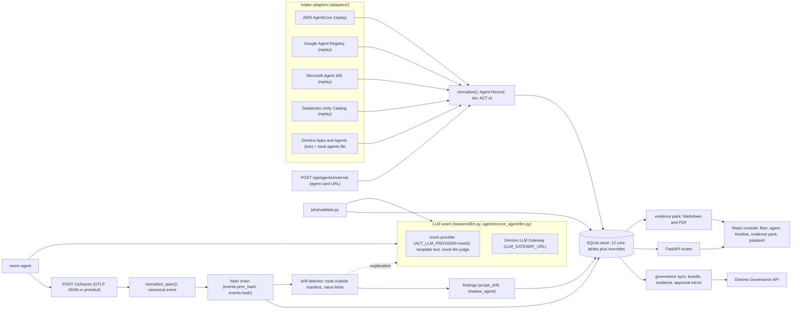
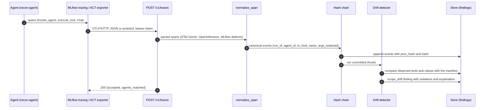
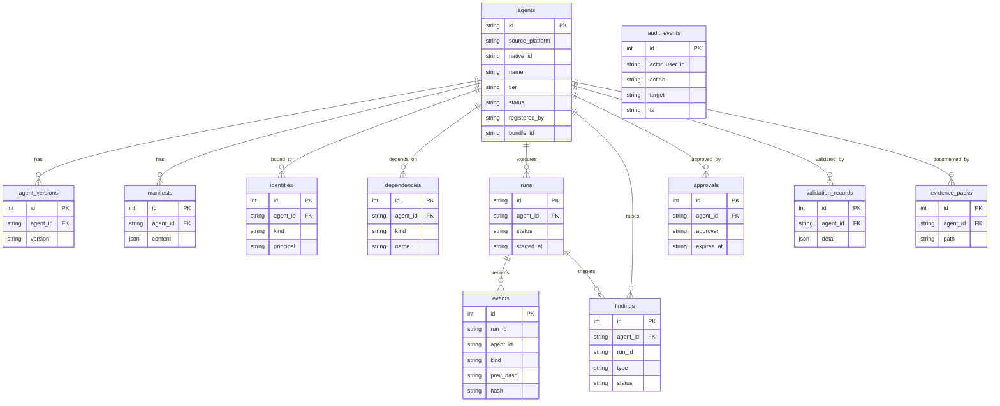

# ACT architecture

ACT (Agent Control Tower) is an evidence layer. It inventories agents from several platforms, records what they
did, and produces dated evidence for governance. It does not block or enforce anything.

## Integration map

Five intake adapters feed one normalizer and one store. Traces from any agent take a second path through the
span normalizer into a hash-chained event log, where the drift detector turns out-of-manifest behaviour into
findings. LLM calls go through one seam that is either the Domino LLM Gateway or an offline mock.

## Trace path

## Data model

The diagram shows the 12 core tables. An additional overrides table (recorded human overrides of findings) is not drawn.

